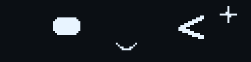
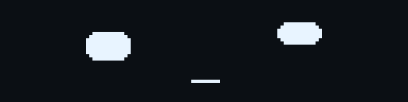
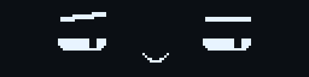
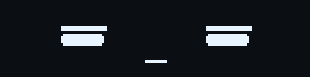
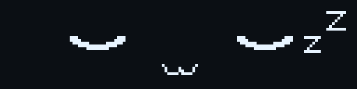
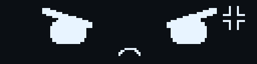
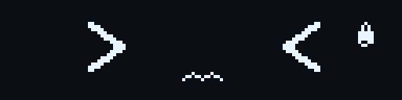
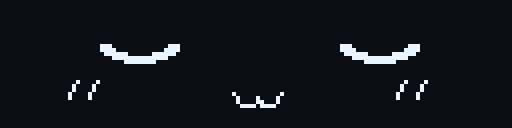
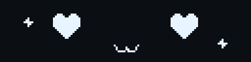

# Face gallery

Every kaomoji face, rendered from the same generator data the firmware uses (each is a 3-second, 30-frame loop). Turn them on with Config / `POST /settings` `{"eyes_style":"kaomoji"}` ([api.md](api.md#kaomoji-eyes)). Faces with no trigger are in the library but not used by any animation yet.

| Face | Preview | Shown for |
| --- | --- | --- |
| Idle |  | idle (`none`), sleep-open |
| Happy |  | `welcome`, `talking` |
| Laugh |  | not used yet |
| Wink |  | `print_start` |
| Curious |  | `reading`, `attention` |
| Thinking |  | `typing`, `thinking` |
| Surprise |  | `ring` |
| Smug |  | not used yet |
| Sleepy |  | `wakeup` |
| Sleep |  | `sleep`, sleep-close |
| Sad |  | `dead` |
| Cry |  | not used yet |
| Angry |  | `error` |
| Panic |  | `abort` |
| Shy |  | not used yet |
| Love |  | not used yet |

Regenerate after editing `scripts/expressions/designs.js`:

```bash
node scripts/expressions/generate.js
node scripts/expressions/render-previews.js
```
